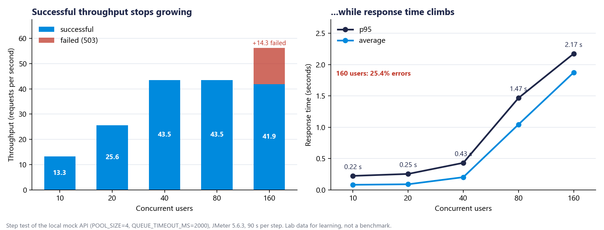
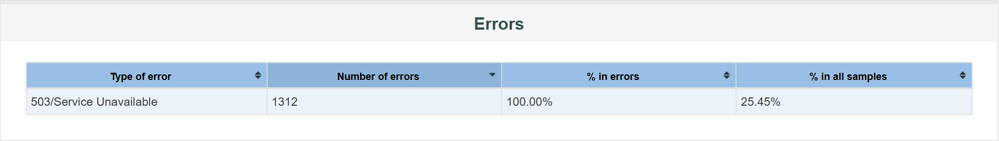
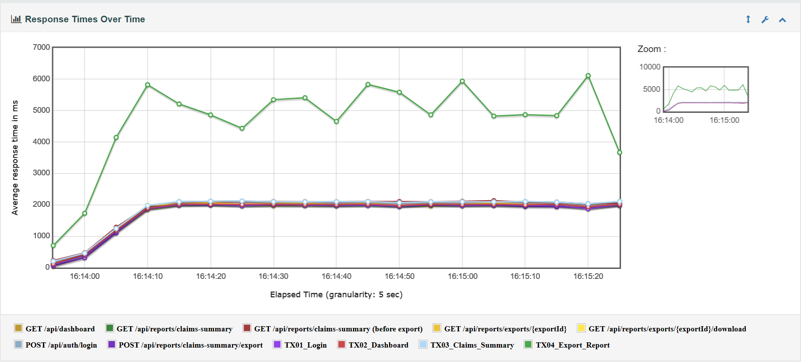

# 14 · Reading results and finding bottlenecks

> **Goal:** read JMeter's numbers with confidence, recognise the common patterns, and turn a result set into a clear conclusion. Includes a worked example with **real data** from a step test against the mock API.
>
> **Tools:** HTML dashboard (Tutorial 10), `scripts/jtl_summary.py`, `scripts/step_load.py`, the mock's `/metrics` · **Data:** `results/sample/`

## A reading order that works

1. **Is the run valid?** The right script, environment, duration and user count (*Active Threads Over Time*)? Was the load generator healthy (CPU below about 80%, no out-of-memory errors in `jmeter.log`)?
2. **Errors first.** Error % per transaction, then *which* errors (*Errors* and *Top 5 Errors by sampler*). Fast errors make response times look better, so always read errors before response times.
3. **Percentiles against the SLO.** p90/p95/p99 per transaction in *Statistics*. Compare with the target, not with how you feel.
4. **Throughput against the target.** Did the test deliver the expected requests or transactions per second (Little's Law)?
5. **Behaviour over time.** *Response Times Over Time*, *Transactions Per Second*: stable, climbing or spiky?
6. **Behaviour against load.** Across steps or in *Time Vs Threads*: where does the response time curve bend?
7. **Server side.** CPU, memory, GC, connection and thread pools, database and queue metrics for the same time window. JMeter shows *that* something is slow; server metrics show *why*.

## The Aggregate Report and Statistics columns

| Column | Meaning | Watch for |
|---|---|---|
| Label | Sampler or transaction name | Use clear names, `TX` prefix for transactions |
| # Samples | How many times it ran | Is the mix right (50/35/15)? |
| Average | Mean response time | Hides the tail; don't use it alone |
| Median (p50) | Half were faster, half slower | The "typical" request |
| 90% / 95% / 99% line | 90/95/99% of samples were at or below this | Compare p95 with the SLO; p99 shows the worst user experience |
| Min / Max | Fastest / slowest | One huge max can be a one-off; check p99 |
| Error % | Failed samples ÷ samples | Any non-zero value needs an explanation |
| Throughput | Samples per second (for the whole test duration) | Against the target load |
| Received / Sent KB/sec | Network traffic | Very large responses, or network limits |

In the HTML report's **Total** row, JMeter counts requests only and leaves out Transaction Controller samples. In our runs its Total matched `jtl_summary.py`'s "ALL REQUESTS" exactly.

## Percentiles in one minute

Sort all 1,000 response times from fastest to slowest:

- **p50** is the 500th value: half of users were faster.
- **p95** is the 950th value: 50 requests (1 in 20) were slower.
- **p99** is the 990th value: 10 requests were slower.

Two systems can have the same 400 ms average: one where everyone waits about 400 ms, and one where 95% wait 100 ms and 5% wait 6 s. Only percentiles tell them apart. Percentiles also can't be averaged: the p95 of a whole test is **not** the average of per-minute p95s.

## Common patterns

| What you see | What it usually means |
|---|---|
| Response time flat, throughput rises with users | Healthy: below capacity |
| **Throughput flattens while response time climbs** | **Saturation.** Requests are queuing for a limited resource (connection pool, thread pool, CPU, lock, downstream service). The knee is your capacity. |
| Errors appear and response times *drop* | Fast failures (for example instant 503s or 401s) are counted as quick samples. Read errors first. |
| Errors are mostly 401/403/404 after one 5xx | **Cascade errors** from the script: a failed login or extraction breaks the rest of the journey. Guard with If Controllers. |
| Response time creeps up over hours at constant load | Leak or build-up: memory, connections, temp tables, log or queue growth (soak test) |
| Saw-tooth response times | Garbage collection pauses, batch jobs, cache expiry |
| High response times from the start, low server CPU | The load generator is overloaded, the network is slow, or a downstream dependency is slow |
| Only the first minute is slow | Warm-up: JIT compilation, cold caches, connection pools filling |
| One transaction slow, others fine | A transaction-specific cause: query, payload size, external call |

## Worked example: a step test on the Claims Summary workload

### Set-up

- **Script:** `10_claims_summary_load.jmx`, stress profile: 4 actions per session, 0.5–1.5 s think time, workload mix 50/35/15.
- **System under test:** the mock API with `POOL_SIZE=4` and `QUEUE_TIMEOUT_MS=2000`, a deliberately small "database connection pool" that rejects requests after waiting 2 s.
- **Steps:** 10, 20, 40, 80 and 160 users, 20 s ramp-up, 90 s each, run by `python scripts/step_load.py --users 10 20 40 80 160 --duration 90 --html-for-last`.
- **Machine:** one Windows laptop running both JMeter 5.6.3 and the mock.

> These are **real measurements of the mock on a laptop**, used to practise reading results. They are not benchmarks of any real system, and the user counts are scaled down. In an interview, quote your own project numbers. If you use this example, say clearly that it's a lab exercise.

### The results (all requests)

| Users | Samples | Avg (ms) | p90 (ms) | p95 (ms) | p99 (ms) | Throughput (req/s) | Error % | Successful (req/s) | Server max queue | Server 503s |
|---:|---:|---:|---:|---:|---:|---:|---:|---:|---:|---:|
| 10 | 1196 | 81 | 171 | 223 | 339 | 13.3 | 0.0 | 13.3 | 1 | 0 |
| 20 | 2297 | 89 | 187 | 254 | 346 | 25.6 | 0.0 | 25.6 | 5 | 0 |
| 40 | 3925 | 202 | 369 | 431 | 543 | 43.5 | 0.0 | 43.5 | 20 | 0 |
| 80 | 3953 | 1044 | 1378 | 1466 | 1624 | 43.5 | 0.0 | 43.5 | 59 | 0 |
| 160 | 5156 | 1874 | 2130 | 2174 | 2296 | 56.2 | 25.45 | 41.9 | 139 | 1312 |

*Server max queue* is the longest queue for a connection the mock has seen since it started (from `/metrics`). *Server 503s* is the number of 503 responses the mock sent during that step.

Per-transaction p95 (from `results/sample/step-test/users-*-by-label.md`):

| Users | TX01_Login | TX02_Dashboard | TX03_Claims_Summary | TX04_Export_Report | Error % |
|---:|---:|---:|---:|---:|---:|
| 80 | 1,394 ms | 1,392 ms | 1,544 ms | 5,900 ms | 0 |
| 160 | 2,048 ms | 2,070 ms | 2,265 ms | 8,212 ms | 30.2 (transactions) |

### Reading it, step by step

**1. Up to 40 users the system scales.** Throughput roughly doubles with users (13 → 26 → 44 req/s). p95 is flat from 10 to 20 users (223 → 254 ms) and rises only modestly at 40 (431 ms).

**2. From 40 to 80 users, throughput stops growing.** It stays at 43.5 req/s while average response time goes up five times (202 → 1,044 ms) and p95 more than triples. Doubling the users only doubled the waiting. That is the **knee**: the system's capacity is about **43–44 requests per second**.

**3. At 160 users it starts failing.** 25.45% of requests fail. The "throughput" of 56 req/s looks better, but only 41.9 req/s succeeded. The extra 14 per second are failures, so the system is doing *less* useful work than at 80 users.

**4. The errors are all one kind.** The HTML report's *Errors* table shows a single type: `503/Service Unavailable`, 1,312 errors. The mock's `/metrics` counted **exactly 1,312** 503 responses in that step, so the client and server tell the same story.

**5. These are slow failures, not fast ones.** Failed requests took about 2 s on average, the mock's queue timeout. Users wait 2 s and then get an error, which is the worst experience.

**6. The server side explains why.** `/metrics` shows the 4-connection pool fully used and up to **139 requests waiting** for a connection at 160 users (59 at 80 users). Response time is almost all **queueing**, not work: an average request needs well under 0.1 s of "database" time (0.3 s at most, for a full-year report).

**7. The numbers agree with each other (always check this).**

- *Capacity:* at 10 users, with no queueing, the average request took 81 ms in total, so database time is a bit less than that. 4 connections ÷ about 0.08 s ≈ 50 requests per second at most. The measured ceiling of 43.5 is in that range: this resource explains the limit.
- *Little's Law at 80 users:* N = X × (R + Z) → 80 = 43.5 × (1.04 + Z) → Z ≈ 0.8 s average gap between a user's requests. That fits the 0.5–1.5 s think time, applied once per action, while an export makes several requests back to back.

**8. Export is the slowest transaction.** At 80 users TX04_Export_Report p95 is 5.9 s, because one export makes several requests (report, start export, polls, download) and each one queues. If export had its own SLO, it would fail first.

### Against the SLO

Scaled to this lab, with the target "Claims Summary p95 under 3 s, errors under 1%":

| Users | Claims Summary p95 | Errors | Verdict |
|---:|---:|---:|---|
| 40 | well under 1 s | 0% | Pass, with headroom |
| 80 | 1.54 s | 0% | Pass, but the system is saturated: no headroom for growth |
| 160 | 2.27 s | 25% | **Fail** (errors) |

### How to report it

> "The Claims Summary workload scales linearly up to about 40 users. Beyond that, throughput is flat at about 43 requests per second while response times rise sharply. That is saturation of the database connection pool: the server shows all 4 connections busy and up to 139 requests waiting. At 80 users we still meet the SLO (Claims Summary p95 1.5 s, 0 errors) but with no headroom. At 160 users 25% of requests fail with 503 after a 2-second wait. The system currently supports about 80 users within target, not 160. Recommended next steps: increase the pool if the database has spare capacity, and reduce database time per request (query tuning or caching for the report). Then re-run the same step test to confirm."

Notice the structure: **where** it breaks, **what** breaks, the **evidence** for the cause, a **clear capacity statement**, and the **next step**.

### After the fix: re-run the same test

A recommendation isn't finished until it's proven. We restarted the mock with **`POOL_SIZE=8`** (the "fix": twice the connections) and re-ran the 80- and 160-user steps with the same script and settings:

| Users | Pool | Avg (ms) | p95 (ms) | Claims Summary p95 | Throughput (req/s) | Error % | Server max queue |
|---:|---:|---:|---:|---:|---:|---:|---:|
| 80 | 4 (before) | 1,044 | 1,466 | 1,544 ms | 43.5 | 0.0 | 59 |
| 80 | **8 (after)** | **185** | **372** | **465 ms** | **89.7** | 0.0 | 30 |
| 160 | 4 (before) | 1,874 | 2,174 | 2,265 ms | 56.2 (41.9 successful) | 25.45 | 139 |
| 160 | **8 (after)** | **1,049** | **1,406** | **1,490 ms** | **85.1** | **0.0** | 113 |

What this proves:

- The ceiling moved from about 43 to about 85–90 requests per second, so the connection pool **was** the bottleneck.
- At 80 users the system now has headroom: p95 dropped by about 75%.
- At 160 users there are no errors, but throughput is flat again (89.7 → 85.1) while response time rises. The knee has moved to somewhere between 80 and 160 users. With 4 → 8 connections we bought about twice the capacity, not unlimited capacity.

In a real system, a bigger pool only helps if the database behind it has spare capacity. Otherwise the queue just moves into the database. That's why you watch database metrics during the re-test too.

Results: `results/sample/after-fix-pool-8/`.

### Two lessons from earlier runs

**Without guards, errors multiply.** Our first version of plan 10 had no If Controllers. At 160 users it reported **3,210** failed samples, but the server had sent only **727** 503s. The rest were cascade errors created by the script: 1,286 × 401 (sessions whose login had failed carried on with no token) and 1,197 × 404 (polling an export that was never created). The error rate (44.8%) and throughput (77.9 req/s) were both badly inflated. Details: `results/sample/unguarded-cascade/`. Lesson: compare JMeter's error count with the server's, and guard dependent steps.

**In a closed model, errors depend on timeouts.** With the mock's queue timeout at 5 s instead of 2 s, the same five steps produced **0 errors**, even at 160 users: p95 3.4 s, throughput still flat at about 42 req/s. With a fixed number of threads, the queue can never be longer than the number of users, so waits stayed under 5 s. Results: `results/sample/closed-model-5s-timeout/`. Lesson: "no errors" doesn't mean "no problem". The flat throughput and rising response times already showed the bottleneck.

## How this maps to the prep guide's mock assessment

The prep guide's Question 3B gives a results table (50 → 300 users) where throughput flattens at about 165 req/s between 200 and 300 users, p95 jumps to 9.5 s and errors reach 4.8%. It's the same pattern as our lab data, and you answer it the same way: scale is fine to about 100 users, throughput flattens while percentiles climb, so it's a bottleneck. The test fails the target at 300 users; find the slowest transaction, check server and database metrics and the load generator, then state the supported capacity (about 200 users within target).

## Exercises

1. Start the mock with `POOL_SIZE=4 QUEUE_TIMEOUT_MS=2000`, run `python scripts/step_load.py --users 10 20 40 80 160 --html-for-last` and compare your table with the one above. Your numbers will differ a little; the shape should not.
2. Open `results/step-load/html-users-160/index.html`. Find the slowest transaction, the error type, and the *Time Vs Threads* chart.
3. Run the soak profile with `LEAK=1` for 15 minutes (`-Jduration=900`), and watch `heapUsedMB` grow in `/metrics`.
4. Write a five-sentence summary of your results using the structure in *How to report it*.

**Next:** [15 · Cheat sheet and interview Q&A](15-cheat-sheet-and-interview-qa.md)
